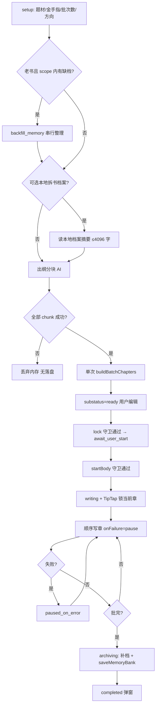
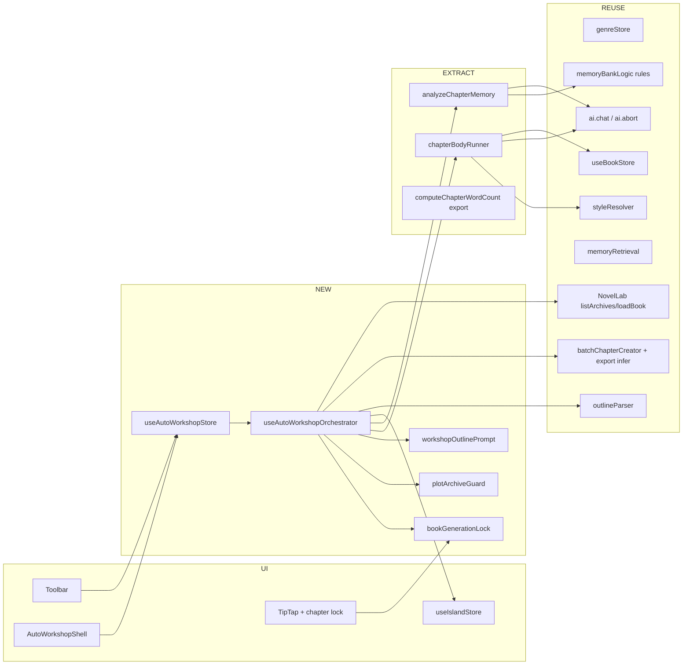
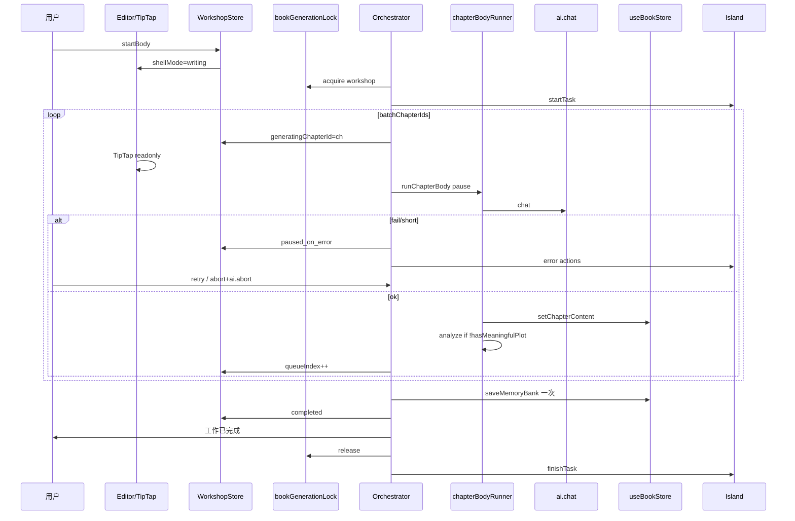

# 写梨眼 Agent 自动工坊（全自动小说写作模式）设计方案

| 字段 | 内容 |
|------|------|
| **文档标题** | Agent 自动工坊（全自动小说写作模式） |
| **作者** | （待填） |
| **日期** | 2026-07-15 |
| **修订** | 2026-07-15 R2（评审 Issue 23–26 闭环） |
| **状态** | **Ready for implementation** |
| **产品版本** | 2.0.7 |
| **代码根目录** | `E:\xieliyan\tauri2` |
| **关联能力** | Agent 题材包、大纲解析、批量章节、智能整理、灵动岛、拆书本地档案参考 |

---

## 1. Overview

写梨眼已有「写作模式」（TipTap 编辑器 + Agent 对话 + 大纲看板）与「批量生成 / 剧情推演」半自动能力，但缺少一条**从题材设定 → 细纲批次 → 锁定 → 逐章正文 → 归档**的端到端无人值守流水线。用户仍需在大纲看板、Agent 对话、记忆银行之间反复切换，才能完成「新书起 50/100 章」或「老书续写下一批」。

本方案新增 **自动工坊（Auto Workshop）** 模式：与现有写作模式**双 UI 共存、共用同一本书数据**，在编辑器工具栏「智能润色」附近切换。流水线严格按产品冻结需求编排：新书走 setup→大纲→用户锁定后直接进入等待开始→用户点击「开始逐章生成」→切回写作模式逐章生成；老书先读剧情档案（**有档硬跳过整理**）、缺档则后台智能整理后继续。进度**只复用灵动岛**；批次完成后走 `saveMemoryBank` 合并路径完成剧情档案 + 角色库归档，并弹窗「工作已完成」。

**核心原则：复用优先**。可 import 的纯逻辑（大纲解析、建章、风格、整理规则、字数）优先抽取共享；**禁止**把组件内私有闭包（如 `MemoryBankModal.analyzeOneChapter`）标成可复用完成项。仅新增模式状态机、工坊壳层 UI、金手指表单、锁定/等待开始、顺序编排器、老书范围选择与缺档回补编排、书籍生成互斥锁、批末归档触发与完成弹窗。

---

## 2. Background & Motivation

### 2.1 当前状态

| 能力 | 现状位置 | 局限 / 复用注意 |
|------|----------|-----------------|
| 写作正文 | `src/pages/Editor.tsx` + TipTap | 人工驱动；写章时需防并发覆盖 |
| 智能润色 | `Toolbar` / `FullReviewDropdown` | 单章人工；工坊入口放其旁 |
| Agent 大纲模式 | `AgentChatPanel` `mode='outline'` | 对话式，非流水线 |
| 弧线规划 | `arcPlannerPrompt.ts` + OutlineBoard 聊天 | 对话+默认少章；**不能直接当工坊 50/100 出纲** |
| 批量建章 | `batchChapterCreator.buildBatchChapters` | `inferNextChapterNumber` **未 export**；title **硬截断 20 字** |
| 批量正文 | `useBatchGenerate` | 空结果 skip；重试 catch 则 **paused**（非一律 skip） |
| 剧情推演 | `PlotDeductionWorkspace` / `EditableOutlineGrid` | 仅视觉参考，不改产品 |
| 大纲看板 | `OutlineBoard.tsx` | **产品交互保持不变** |
| 智能整理规则 | `memoryBankLogic`（`buildSmartOrganizeRules` / `createChapterMemoryFromAnalysis`） | **可 REUSE** |
| 单章整理闭包 | `MemoryBankModal.analyzeOneChapter`（组件内 **未 export**） | **不可直接接线**；须 EXTRACT |
| merge 记忆 | `mergeMemoryKeepingExisting` | **非硬只读**（有 next 时会合并覆盖字段） |
| 有档判定 | `bookContext.hasMeaningfulMemory`（**未 export**）；`isMemoryExtracted` 已 export | 工坊须导出/自建 `hasMeaningfulPlot` |
| 角色合并 | `saveMemoryBank` → `mergeRoleCategoriesWithArchiveRecords` | 批末主路径；**非** `useExtractStore.extractRoles` |
| 进度 | `useIslandStore` | 长任务用 `startTask`；中止需 `ai.abort()` |
| 字数 | `useBookStore` 内 `computeChapterWordCount`（模块私有） | 工坊门禁须 **export 或共享** |
| NovelLab | 本地档案 `listArchives`/`loadBook` + webview 爬 | **无**「URL→顺序 N 章」现成 IPC |
| VIP 门控 | `requireFeatureAccess` | 工坊本期 **不做** VIP |
| 功能开关 | 无 `config.features.autoWorkshop` | MVP **Toolbar 恒显**，不臆造 features 树 |

### 2.2 痛点

1. 新书从 0 章到「有细纲 + 有正文」链路断裂，用户要跨多个面板操作。
2. 老书续写缺少「以剧情档案为唯一真相、有档永不重整理」的硬约束；现网 merge **不能**当只读用。
3. `useBatchGenerate` 与工坊失败策略不同（skip vs 停等），抽取时须策略注入，避免 OutlineBoard 行为回归。
4. 进度 UI 若再造会与灵动岛冲突；产品明确只复用灵动岛。
5. 工坊与大纲看板批量生成可并发踩同一本书，缺少书籍级生成锁。

### 2.3 产品定位

- **自动工坊** = 批处理流水线 UI + 状态机 + 编排器  
- **写作模式** = 人读人改的编辑主界面；正文阶段**切回写作模式**，当前生成章 **TipTap 只读锁定**  
- **大纲看板** = 独立产品能力，**不修改** `OutlineBoard.tsx` 产品交互；共享 hook 抽取允许改实现但行为兼容  

---

## 3. Goals & Non-Goals

### 3.1 Goals

1. 双模式共存：写作模式 ↔ 自动工坊，同书同存储。
2. 新书（0 章为主路径）：题材 → 金手指 → 可选**本地拆书档案**结构参考 → 剧情方向弹窗 → 50/100 细纲 → 可编辑 → 锁定即进入等待开始 → 用户点「开始逐章生成」→ 逐章正文 → 批次归档 → 完成弹窗。
3. 老书：已有剧情档案 **硬跳过 analyze**；出续纲前读档案；缺档暂停→现有整理逻辑（EXTRACT 后）后台补齐→自动继续；编号从 latest+1 起 N 章。
4. 风格 = 当前用户/书籍绑定的 `styleResolver`；题材 = Agent genre pack 下拉（UI 用 `profile.displayName`）。
5. 进度只走 `useIslandStore`；VIP/计费本期不做。
6. 复用优先 + 必要 EXTRACT；组件私有函数不进 REUSE 验收。

### 3.2 Non-Goals

| 项 | 说明 |
|----|------|
| VIP / 计费门控 | 本期 out of scope |
| 修改 OutlineBoard 产品交互 | 不改 `src/pages/OutlineBoard.tsx` 交互契约 |
| 并行多章生成正文 | 必须顺序逐章 |
| 平行 book 存储 | 禁止 |
| 新进度条/进度面板 | 禁止；只用灵动岛 |
| 参考链抄袭式复写 | 仅结构参考 |
| 大纲完成后自动开写 | 必须用户点「开始逐章生成」 |
| MVP 粘贴任意小说 URL 在线抓 N 章 | 见 §4.10；P4/可选 NEW IPC |
| 多书同时跑工坊 | 全局单 session，切书挂起/切换 |
| 静默冷启动自动烧 API 续写 | hydrate 后须用户点继续 |

### 3.3 MVP vs 后续增强

**MVP（P0–P3）**

- 模式切换 + 工坊壳 + 状态机（含 event 表）  
- 新书：setup→分块出纲（NEW prompt）→编辑→锁定→开始→顺序写正文→失败停等→批末归档弹窗  
- 写章中当前章 TipTap 只读；书籍生成互斥锁  
- 老书：档案硬跳过、范围语义冻结、缺档回补、编号顺延、标题长度工坊路径放宽  
- 本地拆书档案作可选结构参考（非 URL 在线抓）  
- 冷启动：`writing` hydrate → 降为可继续的暂停态  

**后续（P4+）**

- 可选 `novel_lab_fetch_structure_sample` IPC + 站点白名单  
- 用户主动暂停（非错误）  
- 冷启动一键静默续跑（仍建议确认）  
- VIP 门控、自定义非 50/100 批  

---

## 4. Proposed Design

### 4.1 用户可见双模式

```
┌─────────────────────────────────────────────────────────────┐
│ Toolbar: [剧情档案] | … | [剧情导航] [智能润色 ▾] [自动工坊]     │
├──────────┬──────────────────────────────┬───────────────────┤
│ 章节列表  │  写作模式: TipTap              │ Agent / 角色等     │
│          │  或 自动工坊: 流水线壳层        │                   │
└──────────┴──────────────────────────────┴───────────────────┘
                    灵动岛（全局，唯一进度 UI）
```

- **切换点**：`FullReviewDropdown`（智能润色）旁 pill「自动工坊」。  
- **开始正文**：`phase → writing`，**强制** `shellMode = writing` 显示 TipTap。  
- **生成中章节**：`lockedChapterId = 当前 queue 章` → TipTap **只读**（禁用输入/粘贴/AI 改写入口对该章）；完成后解锁该章，再锁下一章。  
- 用户可切换查看其他已完成章并编辑；**禁止**编辑当前生成中章。  
- 工坊非 writing 时，可随时回写作模式查看；session 持久化不销毁。

### 4.2 状态机（修订：取消独立 `locked` 相）

**单一真相：`phase` + `outlineSubstatus`（仅 `outlining` 使用）。**  
`outlineLocked` **派生**：`phase ∈ {await_user_start, writing, paused_on_error, backfill_memory, archiving, completed}` 时视为大纲只读（`setup`/`outlining` 可编）。

**`outlineSubstatus`（仅 phase=`outlining`）**：

| 值 | 含义 | 允许操作 |
|----|------|----------|
| `idle` | 已进入 outlining、尚未/不再跑 AI | 可 `generateOutlines` /（若已 ready 过）编辑 |
| `generating` | 分块出纲 AI 进行中 | **禁止** lock / regenerate / 编辑落盘冲突写 |
| `ready` | 本批已落盘且通过就绪校验 | 可编辑细纲、`lock`、`regenerate` |
| `failed` | 出纲失败（无残章） | 可 `regenerate`（从空批重来） |

#### 4.2.0 老书缺档与出纲：**严格串行**（Issue 23 / KD-23）

**冻结策略（方案 1，写死）**：缺档回补 **必须在** 任何出纲 AI 之前完成；**禁止** `backfill_memory` 与 outline 分块 `ai.chat` 并行。

```
submitSetup 之后：
  扫描 scope 内缺档（有正文、无 meaningful plot）
  if 有缺档:
    phase = backfill_memory
    用户确认「是否现在整理」→ 串行 analyzeChapterMemory（有档硬 skip）
    完成 → backfillDone → phase = outlining, substatus = idle
    → 自动 generateOutlines（此时才允许出纲 AI）
  else:
    phase = outlining, substatus = idle
    → 立即 generateOutlines
```

- `backfill_memory` 期间：**禁止** `generateOutlines` / `regenerate` / `lock` / `startBody`。  
- 新书无正文缺档扫描 → 直接 `outlining` + 出纲。  
- 灵动岛在 backfill 与 outline 阶段分别 `startTask`，不重叠两个长任务。

```
idle ──startSession──► setup
setup ──submitSetup──► backfill_memory   （仅当老书 scope 内有缺档）
setup ──submitSetup──► outlining         （无缺档 / 新书；substatus=idle 后立刻 generating）
backfill_memory ──backfillDone──► outlining  （然后才 generateOutlines；禁止与 backfill 并行）
outlining ──lock──► await_user_start     （仅 substatus=ready 且守卫通过）
await_user_start ──unlock──► outlining   （substatus 保持 ready）
await_user_start ──startBody──► writing  （守卫见 §4.2.3）
writing ──chapterFail──► paused_on_error
paused_on_error ──retry──► writing
paused_on_error ──abort──► idle
writing ──allDone──► archiving ──► completed
* ──abort──► idle（清理 queue 运行态，保留已落盘章节）
hydrate: writing → paused_on_error（须用户点继续，禁止自动烧 API）
```

#### 4.2.1 Event → Transition 表

| 当前 phase | 事件 | 下一 phase | 守卫 / 副作用 |
|------------|------|------------|----------------|
| `idle` | `startSession(bookId)` | `setup` | 绑定 bookId；shellVisible=true |
| `setup` | `submitSetup` | **`backfill_memory`** | **仅当**老书且 scope 内存在可整理缺档；**禁止**启动出纲 AI；记 `backfillChapterIds` |
| `setup` | `submitSetup` | **`outlining`** | 无缺档；substatus=`idle`→随即 `generateOutlines`（sub=`generating`） |
| `setup` | `abort` / `reset` | `idle` | 清 session |
| `backfill_memory` | `backfillDone` | `outlining` | 全部缺档已处理或用户确认跳过不可整理项；**然后** `generateOutlines`；**永不**与 backfill 并行出纲 |
| `backfill_memory` | `abort` | `idle` | `ai.abort()`；finishTask |
| `outlining` | `generateOutlines` / 内启 | `outlining` | sub→`generating`；跑分块 AI（§4.8.2） |
| `outlining` | `outlinesReady` | `outlining` | 落盘成功且通过 §4.2.3 就绪校验；sub→`ready`；写入 `batchChapterIds` |
| `outlining` | `outlineFailed` | `outlining` | sub→`failed`；内存结果已丢；无新章 |
| `outlining` | `lock` | **`await_user_start`** | **守卫 §4.2.3 lockGuards**；细纲只读 |
| `outlining` | `regenerate` | `outlining` | **策略 §4.8.5**；sub→`generating`；backfill/generating 中 **禁止** |
| `await_user_start` | `unlock` | `outlining` | sub=`ready`；可再编辑 |
| `await_user_start` | `startBody` | `writing` | **守卫 §4.2.3 startBodyGuards**；切写作模式；获 gen lock；跑队列 |
| `writing` | `chapterSuccess` | `writing` | queueIndex++；换锁章 |
| `writing` | `chapterFail` | `paused_on_error` | 释放 AI；保留 generatingChapterId 只读 |
| `writing` | `batchBodyDone` | `archiving` | 批末归档 |
| `writing` | `abort` | `idle` | `ai.abort()`；finishTask；释放 gen lock；解锁 TipTap |
| `paused_on_error` | `retry` | `writing` | 从 failedChapterId 重试 |
| `paused_on_error` | `abort` | `idle` | 同上 abort |
| `archiving` | `archiveDone` | `completed` | WorkDoneDialog |
| `completed` | `dismiss` | `idle` | shell 可关；保留书数据 |
| 任意（有 session） | `hydrate` | 见 §4.2.2 | |
| 任意 | `switchBook` | 见 §6.6 | persist 旧 + hydrate 新 |

#### 4.2.3 lock / startBody 就绪守卫（Issue 25 / KD-25）

```typescript
function lockGuards(session, book): boolean {
  if (session.phase !== 'outlining') return false;
  if (session.outlineSubstatus !== 'ready') return false;
  if (session.batchChapterIds.length !== session.batchSize) return false;
  // 本批每一章 outline 去空白后非空
  return session.batchChapterIds.every(id => {
    const ch = book.chapters.find(c => c.id === id);
    return Boolean(ch?.outline?.trim());
  });
}

function batchOutlinesReady(session, book): boolean {
  if (session.batchChapterIds.length !== session.batchSize) return false;
  return session.batchChapterIds.every(id => {
    const ch = book.chapters.find(c => c.id === id);
    return Boolean(ch?.outline?.trim());
  });
}

function startBodyGuards(session, book, genLock): boolean {
  if (session.phase !== 'await_user_start') return false;
  if (!batchOutlinesReady(session, book)) return false;
  if (genLock.getOwner(session.bookId) === 'batch') return false;
  return genLock.acquire(session.bookId, 'workshop');
}
```

- UI：`锁定` / `开始逐章生成` 在守卫失败时 **disable** + tooltip 说明原因（「出纲未完成」「细纲有空章」「批量生成占用中」等）。  
- transition 层再次校验，防止绕过 UI。

#### 4.2.2 Hydrate 规则（MVP 冻结）

| 磁盘 phase | hydrate 后 | UI |
|------------|------------|-----|
| `setup` / `await_user_start` / `completed` | 原样 | 可继续操作 |
| `outlining` | 原样；若磁盘 sub 为 `generating` → 降为 `failed` 或 `idle`（禁止自动续出纲 AI） | 用户点重新生成/继续 |
| `writing` | **`paused_on_error`** | 提示「点击继续」；**禁止**自动调 AI |
| `paused_on_error` | 原样 | 重试/中止 |
| `backfill_memory` / `archiving` | 降为 `paused_on_error` 并标记 `resumeAction` | 用户确认后继续回补或归档；**不**并行出纲 |
| 岛上 actions 闭包 | **不**序列化 | 每次 hydrate 重建 actions |

### 4.3 新书流水线（主路径）



### 4.4 老书路径

前置：`book.chapters.length > 0`（或已有有效 memoryBank）。

**出纲前序（强制）**：见 §4.2.0 —— 先 `backfill_memory` 完成，再 `outlining`/`generateOutlines`；禁止并行。

#### 4.4.1 档案只读（硬规则 — Issue 2 闭环）

**禁止**依赖 `mergeMemoryKeepingExisting` 实现只读。

编排器在任何 analyze / 回补 / 写后整理前：

```typescript
// src/utils/workshop/plotArchiveGuard.ts  NEW（可抽 hasMeaningfulPlot）
export function hasMeaningfulPlot(memory?: ChapterMemory): boolean {
  if (!memory) return false;
  const synopsis = (memory.plotAnalysis?.plotSynopsis
    || memory.plotAnalysis?.functionSummary
    || '').trim();
  // 产品定义：有非空 plotSynopsis（或 functionSummary）即「有档」
  return synopsis.length > 0;
}

export function shouldSkipAnalyze(memory?: ChapterMemory): boolean {
  return hasMeaningfulPlot(memory);
}
```

- `shouldSkipAnalyze === true` → **完全不调用** AI 整理，不写该 chapterId 的 bank 条目。  
- 可选：从 `bookContext` **export** 对齐逻辑，或单测锁定上述定义。  
- `isMemoryExtracted` 可作辅助，但验收以 **plotSynopsis 非空** 为准。

#### 4.4.2 档案范围语义（Issue 14 冻结）

按 **`book.chapters` 数组顺序**（非「前 100 条有效档案条数」）：

| 选项 `ArchiveScope` | 语义 |
|---------------------|------|
| `all` | 全书 chapters 中 **有档** 的章节进入候选 |
| `first_100` | 顺序下标 `0..99` 章中有档者 |
| `first_200` | 顺序下标 `0..199` 章中有档者 |

**注入预算（硬上限）**：

| 层级 | 规则 |
|------|------|
| 全量索引 | `buildFullSummaryIndex` 结果整体截断 **≤ 6000 字** |
| 详细 synopsis | 在范围内再取 **最近 M=20** 章有档者，每章 plotSynopsis **≤ 400 字** |
| 合计详细块 | **≤ 20 × 400 = 8000 字** |
| 分块出纲时 | 每块 user 消息：全局 bible（§4.8）+ 上述压缩上下文 + 本块指令；总 user **建议 ≤ 24k 字**（超则先砍详细） |

缺档扫描范围 = 用户选的 scope 对应章节集合中 `!hasMeaningfulPlot` 且 **有足够正文**（`wordCount >= 30` 或 plain 长度足够）者；无正文无法整理的章提示用户，不阻塞「仅基于已有档出纲」若用户选择跳过（MVP：有正文缺档必须回补或用户 abort）。

#### 4.4.3 编号

- **export** `inferNextChapterNumber`（现为 `batchChapterCreator` 私有）。  
- 最新章号 101、批 50 → 创建 **102–151**。  
- 仅创建本批章节。

#### 4.4.4 老书尾部「空壳章」决策（Issue 10）

**决策（升格）**：续纲 / `buildBatchChapters` **一律追加新章**（latest+1 起）。  
若检测到尾部存在「无正文（wordCount &lt; 200 且 content 近空）但已有 outline」的章节：

- 锁定前壳层 **Warning**：列出这些章，建议用户去写作模式清理或纳入手工处理；  
- **不**自动覆盖其 outline；  
- 本批仍追加新号段，避免静默改写用户已有细纲。

### 4.5 架构总览



### 4.6 模块职责与文件落点

| 模块 | 路径（建议） | 类型 | 职责 |
|------|--------------|------|------|
| 模式壳 | `src/components/workshop/AutoWorkshopShell.tsx` | NEW | 步骤 UI |
| 状态 store | `src/store/useAutoWorkshopStore.ts` | NEW | phase/session/bookId 绑定 |
| 编排器 | `src/hooks/useAutoWorkshopOrchestrator.ts` | NEW | 出纲/写章/回补/归档/abort |
| 书籍生成锁 | `src/utils/workshop/bookGenerationLock.ts` | NEW | workshop \| batch 互斥 |
| 档案守卫 | `src/utils/workshop/plotArchiveGuard.ts` | NEW | hasMeaningfulPlot / shouldSkipAnalyze |
| 单章整理 | `src/utils/workshop/analyzeChapterMemory.ts` | **EXTRACT** | 从 Modal/batch **抽出** 可 import 纯异步函数 |
| 写章队列 | `src/utils/workshop/chapterBodyRunner.ts` | **EXTRACT** | 单章生成+可选整理；`onFailure: 'skip'\|'pause'` |
| 出纲 prompt | `src/Agent/workshopOutlinePrompt.ts` + Rust 加密 key | **NEW** | 非直接 arc finalize |
| 金手指等 UI | `src/components/workshop/*` | NEW | 表单/对话框 |
| 建章 | `batchChapterCreator` | REUSE+改 | export infer；workshop 标题长度 |
| 解析 | `outlineParser` | REUSE | |
| 风格 | `styleResolver` | REUSE | |
| 字数 | `useBookStore` 或 `utils/chapterWordCount.ts` | EXTRACT export | 与侧栏一致 |
| 角色/档案落盘 | `useBookStore.saveMemoryBank` | REUSE | 批末主路径 |
| 进度 | `useIslandStore` | REUSE | startTask + abort |
| 本地拆书参考 | NovelLab `listArchives` / `loadBook` | REUSE | MVP 参考源 |
| OutlineBoard | `OutlineBoard.tsx` | **不改产品交互** | |

**明确删除的错误表述**：不将 `MemoryBankModal.analyzeOneChapter`、`mergeMemoryKeepingExisting` 作为「只读/整理完成项」REUSE。

### 4.7 批次与批末归档（Issue 7 闭环）

- **该批** = 启动时选定范围（新书 1–N；老书 latest+1…+N）。  
- **归档触发** = 该批**全部正文成功**后 `archiving`。

**批末归档步骤（唯一主路径）**：

1. 对本批每个 `chapterId`：若 `shouldSkipAnalyze` → 跳过；否则若正文足够 → 调 **`analyzeChapterMemory`**（EXTRACT 模块）写入 bank 数组（内存合并）。  
2. **一次** `saveMemoryBank(bookId, mergedBank)`（`skipMerge=false` 除非 `disableAutoRoleExtract`）：  
   - 触发现有 `mergeRoleCategoriesWithArchiveRecords` → 角色库更新。  
3. **不**默认调用 `useExtractStore.runExtract` / 全量 `extractRoles`。  
4. 尊重 `config.ai.disableAutoRoleExtract`：为 true 时整理可不产出/不合并角色（与现网一致）。  
5. `phase → completed` + `WorkDoneDialog`「工作已完成」。

写后逐章整理（可选即时）：同样走 `analyzeChapterMemory` + 有档 skip；失败 **不阻塞** 下一章正文（KD-Q1）。

### 4.8 大纲生成（Issue 9 / 10 闭环）

#### 4.8.1 Prompt：**NEW** 专用，不直接 arc finalize

- Rust 加密 key 建议：`workshop_outline_system`（discuss 不需要）。  
- **借鉴** arc finalize 的输出格式与三大规划法则，但契约不同：  
  - **无**多轮 conversationHistory 依赖  
  - **强制**本块输出 `chunkSize` 章（及全局剩余）  
  - 注入：题材、金手指、剧情方向（严格/自主）、全局 bible、参考结构摘要、老书压缩档案  
- `workshopOutlinePrompt.ts` 只组装 messages，**不**调用 `buildArcPlanningMessages` 作为主路径（可复制少量 format 工具函数若需要）。

#### 4.8.2 分块算法（all-or-nothing 落盘）

```
chunkSize = 10  （可配置；100 章 → 10 块）
globalBible = { genre, goldenFinger, plotDirection, characterSeeds?, referenceStructureSummary截断 }
parsedAll: ParsedChapterOutline[] = []  // 仅内存

for chunkIndex in 0..numChunks-1:
  messages = buildWorkshopOutlineChunkMessages({
    globalBible,
    previousTailOutlines: parsedAll.slice(-3),  // 块间衔接：末 2–3 章细纲
    chapterStartNo, chapterEndNo,
    oldBookArchiveBudget...
  })
  text = ai.chat(...)
  part = parseOutlineFromResponse(text)
  if !part.success || part.chapters.length != expectedCount:
    retry once
    if still fail: discard parsedAll; return error  // 不落盘任何本批新章
  validate continuous chapter numbers
  parsedAll.push(...part.chapters)
  island update 块进度

// 仅此处落盘（「已提交」边界）
// 若 session.batchChapterIds 已有值：须先走 §4.8.5 删除旧批，禁止直接再 append
chaptersResult = buildBatchChapters(book, parsedAll, { maxTitleLength: 40 })
await updateBook append newChapters
session.batchChapterIds = newChapters.map(c => c.id)
for each outline: setChapterOutline
outlineSubstatus = ready
```

- **术语**：  
  - **未提交** = 仅内存 `parsedAll`，尚未 `updateBook`。  
  - **已提交** = 已 `updateBook` + `batchChapterIds` 非空。  
- **失败**：丢弃内存 `parsedAll`；**不**调用 `buildBatchChapters`；不留下半批空章；sub→`failed`。  
- **新书 0 章**：startNumber=1。  
- **老书**：首次本批追加；空壳章策略见 §4.4.4；**重新生成不得二次 append**（§4.8.5）。

#### 4.8.3 标题长度（Issue 4）

- 现网 `buildBatchChapters`：`` `第${n}章 ${title}`.slice(0, 20) `` 对「第102章 」不友好。  
- **改动**：  
  1. `export function inferNextChapterNumber`  
  2. `buildBatchChapters(book, parsed, options?: { maxTitleLength?: number })`  
     - 默认 `20` 保持 OutlineBoard/Agent 旧行为  
     - 工坊传 `maxTitleLength: 40`（或仅截断 **subtitle** 部分：前缀 `第N章 ` 不计入 20）  
  3. **推荐算法**：`const prefix = \`第${chapterNo}章 \`; title = prefix + parsed.title.slice(0, maxTitleLength - prefix.length)` 且 `maxTitleLength` 工坊=40。  
- 任务验收：第 102 章标题可读，不被截成「第102章」无副题。

#### 4.8.4 编辑 / 锁定

- `outlining` 且 sub=`ready`：可改 title/outline。  
- `lock` 仅当 **§4.2.3 lockGuards** 通过 → **`await_user_start`**。  
- `unlock` → `outlining`（sub=`ready`）。  
- **不**在出纲完成时自动 `startBody`。

#### 4.8.5 重新生成 `regenerate`（Issue 24 / KD-24）

| 场景 | 行为 |
|------|------|
| **未提交**（仅内存 `parsedAll` / sub=`generating` 中止后） | 丢弃内存；不改 `book.chapters`；重新分块出纲 |
| **已提交**（`batchChapterIds.length > 0`） | **禁止**再次直接 `buildBatchChapters` 追加。流程：① 确认弹窗「将删除本批 N 个章节细纲/空章并重新生成」；② 删除本批章节（优先 `recycledChapters` 回收站路径，与现网删章一致；若章已有大量正文 wordCount≥200 则 **阻断 regenerate** 并提示先解锁后手工处理）；③ `batchChapterIds=[]`，queueIndex=0；④ all-or-nothing 再出纲并 **新** ids 写回 session |
| sub=`generating` / phase=`backfill_memory` | **禁用** regenerate 按钮 |
| 验收单测 | 已落盘后 regenerate：**不得**出现 chapter 数 +batchSize 且旧批仍在；必须先删旧批再加新批，净增约 0（同 batchSize 替换） |

### 4.9 正文生成

#### 4.9.1 Shared runner 契约（Issue 11）

```typescript
// chapterBodyRunner.ts
export type BodyFailurePolicy = 'skip' | 'pause';

export interface RunChapterBodyOptions {
  bookId: string;
  chapterId: string;
  onFailure: BodyFailurePolicy;  // batch: 空结果 skip；catch 可 pause — 保持现语义映射
  minWordCount?: number;         // workshop: 1800 soft floor
  skipAnalyzeIfMeaningfulPlot?: boolean; // workshop/old book: true
  signal?: { abort: boolean };
}

export async function runChapterBody(opts: RunChapterBodyOptions): Promise<'ok' | 'skipped' | 'paused' | 'aborted'>
```

- **OutlineBoard / useBatchGenerate**：`onFailure` 映射为现网行为（空→skip；重试 catch→pause），**行为零感知**。  
- **工坊**：空/过短/异常 → 重试 1 次 → 仍失败 → **`pause`**（`paused_on_error`），**无 skip**。  
- PR-3 必跑 `tests/batchGenerate.test.ts` + 手工 OutlineBoard 批量一次。

#### 4.9.2 字数门禁（Issue 15）

- **export** `computeChapterWordCount`（或抽到 `src/utils/chapterWordCount.ts` 供 store 与工坊共用）。  
- 计量与侧栏一致：去 HTML、去空白、去掉与 title 相同前缀。  
- Soft floor：**1800**（产品「约 2000」）；`wordCount < 1800` → 视为本章失败进入 pause。  
- UI 文案：「字数未达约 2000（当前 xxx）。可重试或中止。系统不会自动注水凑字。」  
- 禁止二次 prompt「注水补字」。

#### 4.9.3 顺序与模式

1. 获 `bookGenerationLock.acquire(bookId, 'workshop')`；若 batch 占用 → toast 拒绝。  
2. 灵动岛 `startTask`（locked entry）。  
3. 对 queue：`setCurrentChapter` → **TipTap readonly** → `runChapterBody` → 解锁 → 下一章。  
4. 自动下一章，无需用户点。  
5. 中止：`abortRef=true` + `electronAPI.ai.abort()` + `finishTask` + 释放锁 + 清 readonly。

#### 4.9.4 写章 prompt 增量

```text
【本章细纲】
{outline}

【输出要求】
1. 完整覆盖细纲情节要点，写完自然结束；
2. 正文字数不少于约 2000 字，禁止注水、重复描写、无意义对话凑字；
3. 仅输出小说正文。
```

system 侧继续可走 `get_batch_generate_prompt`，user 侧加工坊约束；或后续独立 workshop body prompt key（非 MVP 阻塞）。

### 4.10 参考结构（Issue 3 闭环）

**MVP 不提供「粘贴任意小说 URL → 自动抓 N 章」。**

| 阶段 | 能力 |
|------|------|
| **MVP** | 可选：「从 Novel Lab 本地已拆书档案选择」→ `listArchives` / `loadBook` → 取约 min(N, 可用章) 做**结构摘要**（冲突/场景骨架，每章 ≤80 字，合计 ≤4k 字）→ 写入 session（截断） |
| **P4 可选** | **NEW IPC** `novel_lab_fetch_structure_sample { url, maxChapters, siteAllowlist }`；失败降级为无参考；站点白名单与拆书配置对齐 |

反抄袭 system 条款保留。P1 验收 **不**依赖在线 URL。

### 4.11 金手指

| 选项 | 行为 |
|------|------|
| 随机 | 题材本地模板池（MVP 不强制 AI）；可编辑；maxlength 2000 |
| 自定义 | 多行；maxlength 2000；控制字符清理 |
| 没有金手指 | `goldenFinger: null`，prompt 明确无系统外挂 |

### 4.12 剧情方向弹窗

- 出纲前强制；可空=AI 自主；有内容=严格遵循。  
- maxlength 4000；清理控制字符。  
- system 注明：「用户方向为创作意图，不得覆盖安全/格式硬约束」。  
- 老书附加：batchSize、ArchiveScope。

### 4.13 进度与中止（Issue 12）

```typescript
const taskId = useIslandStore.getState().startTask({
  type: 'progress',
  status: 'thinking',
  message: `自动工坊：第 ${i}/${n} 章`,
  detail: title,
  actions: [{
    id: 'abort-workshop',
    label: '中止',
    onClick: () => {
      orchestrator.abort(); // 内含 electronAPI.ai.abort()
    }
  }],
});
// 更新：updateTask(taskId, { message, status: 'writing' })
// 成功短暂：finishTask(taskId); show({ type:'success', ... autoHide })
// 失败：finishTask 或保留 task；show({ type:'error', actions: [重试, 中止] })
```

- 长任务 **禁止**仅用会被 toast 挤掉的短暂 `show` 作为唯一进度。  
- 中止路径对齐 `MemoryBankModal` L416：`abort` + `ai.abort()`。

### 4.14 与 useBatchGenerate / 互斥（Issue 11 / 16）

| 维度 | batch（OutlineBoard） | 工坊 |
|------|----------------------|------|
| runner | 共享 `chapterBodyRunner` | 同 |
| onFailure | skip/pause 映射现网 | 仅 pause |
| 入口互斥 | `bookGenerationLock` | 同 |
| OutlineBoard.tsx | 产品交互不改 | — |

```typescript
// bookGenerationLock.ts
type Owner = 'workshop' | 'batch';
acquire(bookId: string, owner: Owner): boolean
release(bookId: string, owner: Owner): void
getOwner(bookId: string): Owner | null
```

一方 running：另一方按钮 disable + 灵动岛/toast「该书正在自动生成中」。

### 4.15 TipTap 写锁（Issue 6）

- `useAutoWorkshopStore.generatingChapterId: string | null`  
- `TiptapEditor` / Editor：`editable = !(generatingChapterId === currentChapterId && phase === 'writing'|'paused_on_error')`  
  - pause 等待用户时仍保持只读，直到 retry 成功或 abort。  
- `setChapterContent` 仅由 runner 写入生成中章；用户无法键入竞态。  
- 切换前 `forcePersistCurrentEditor` 保留。

---

## 5. API / Interface Changes

### 5.1 Store

```typescript
export type WorkshopPhase =
  | 'idle'
  | 'setup'
  | 'outlining'
  | 'await_user_start'  // lock 后直接进入；无独立 locked
  | 'writing'
  | 'paused_on_error'
  | 'backfill_memory'
  | 'archiving'
  | 'completed';

export interface AutoWorkshopSession {
  bookId: string;
  phase: WorkshopPhase;
  batchSize: 50 | 100;
  genreId: string;
  goldenFingerMode: 'random' | 'custom' | 'none';
  goldenFingerText: string;           // max 2000
  plotDirection: string;              // max 4000
  /** MVP：本地档案路径/id，非任意 URL */
  referenceArchiveId?: string;
  /** 结构参考摘要；全文统一硬上限 4096 字（超出截断） */
  referenceStructureSummary?: string;
  isOldBook: boolean;
  archiveScope?: 'all' | 'first_100' | 'first_200';
  batchChapterIds: string[];
  queueIndex: number;
  /** outlining 子状态；仅 phase=outlining 有意义 */
  outlineSubstatus?: 'idle' | 'generating' | 'ready' | 'failed';
  failedChapterId?: string;
  lastError?: string;
  generatingChapterId?: string | null;
  backfillChapterIds?: string[];
  resumeHint?: string;                // hydrate 文案
  updatedAt: string;
}

// outlineLocked 不持久化，由 phase 派生
// REFERENCE_STRUCTURE_SUMMARY_MAX = 4096（§4.10 / §6.2 / §8 全文一致，禁止 4–8k 表述）
```

全局 store **单 session**：`session.bookId` 必须与当前编辑书一致；切书见 §6.6。

### 5.2 EXTRACT 模块签名

```typescript
// analyzeChapterMemory.ts
export async function analyzeChapterMemory(params: {
  bookId: string;
  chapter: Chapter;
  /** 若已有档则调用方不应进来；函数内二次守卫 */
  force?: boolean;
}): Promise<ChapterMemory | null>

// chapterBodyRunner.ts — 见 §4.9.1
```

`MemoryBankModal` / `useBatchGenerate` 逐步改为调用上述模块（可同 PR-3 完成 batch 侧）。

### 5.3 Toolbar / Editor

```typescript
// Toolbar：智能润色旁
// MVP：恒显「自动工坊」，无 config.features
editorMode?: 'writing' | 'workshop';
onToggleWorkshop?: () => void;
workshopBusy?: boolean; // 可选指示

// Editor
// shellMode + generatingChapterId → TipTap editable
// startBody 时 setShellMode('writing')
```

### 5.4 后端 / IPC

| 项 | MVP | 说明 |
|----|-----|------|
| `workshop_outline_system` 加密 prompt | **需要** | NEW key，非 arc finalize 直调 |
| `get_batch_generate_prompt` | 复用 | 写章 system |
| `novel_lab_fetch_structure_sample` | **不做** | P4 可选；接口草案见下 |
| settings 存 session | 现有 saveBook | 注意体量 §6 |

**P4 IPC 草案（非 MVP）**：

```typescript
// invoke('novel_lab_fetch_structure_sample', {
//   url: string,
//   maxChapters: number,
//   // 服务端校验 allowlist
// }) -> { ok, chapters: { title, structureBeat }[], error? }
```

### 5.5 功能开关（Issue 8）

- **MVP**：Toolbar 入口 **恒显**（与多数写作工具一致）。  
- **不做** `config.features.autoWorkshop`（代码中不存在该树）。  
- 若日后需要：扩展 `AppConfig` 显式字段并写默认值 `true`，再接线；非本期。

---

## 6. Data Model Changes

### 6.1 无平行书库

章节 / 细纲 / memoryBank / resourceIndex 仍现网模型。

### 6.2 Session 挂载与体量（Issue 13）

```typescript
// BookSettings
autoWorkshop?: AutoWorkshopSession; // 可序列化快照
```

**限制**：

| 字段 | 上限 |
|------|------|
| `referenceStructureSummary` | **4096 字**（超则截断；或 P4 sidecar） |
| `goldenFingerText` | 2000 |
| `plotDirection` | 4000 |
| `batchChapterIds` | ≤ 100 个 UUID |

**写入策略**：

- setup 字段：debounce **1s** `updateBook`  
- lock / phase 变更 / 每章完成 queueIndex：合并写入；避免每 keystroke 全量 save  
- 若后续有 patch API 再优化；MVP 用 debounce + 合并 patch 对象  

**切书**：

1. persist 当前 session → 旧书 settings  
2. `session = null` 后 hydrate 新书 `settings.autoWorkshop`  
3. 若新书无 session → idle  

**多窗口**：同一 bookId 以最后写入为准；gen lock 进程内有效（单桌面主窗口假设与现网一致）。

### 6.3 Chapter

继续 `outline` / `content` / `wordCount`；无 chapter 级锁字段（锁在 session.generatingChapterId）。

### 6.4 ChapterMemory

- 有档判定：`hasMeaningfulPlot`（§4.4.1）  
- 写入前编排器 skip；**不**把 `mergeMemoryKeepingExisting` 当只读  

### 6.5 迁移

- 缺省 `autoWorkshop: undefined`  
- 无破坏性迁移  

### 6.6 持久化时机

| 事件 | 策略 |
|------|------|
| setup 编辑 | debounce |
| 出纲成功 / lock / unlock / 失败 / 完成 | 立即 |
| queueIndex++ | 立即（或与 setChapterContent 同临界区合并一次 updateBook） |
| hydrate writing | 写回 paused 态，立即 persist 避免再当 writing 自动跑 |

---

## 7. Alternatives Considered

### A. OutlineBoard 内嵌流水线  
否决：违反看板不变 + 入口不在编辑器主路径。

### B. 全新生成引擎不抽取 batch  
否决：双份逻辑；与复用优先冲突。

### C. 正文留在工坊壳不回写作模式  
否决：违反产品冻结。

### D.（采纳）Editor 双壳 + EXTRACT runner + 编排器硬守卫  
采纳。

### E. 用 mergeMemoryKeepingExisting 当只读  
否决：代码会合并覆盖；改为硬 skip analyze。

### F. MVP 做 URL 在线抓章  
否决/推迟：无现成 IPC；改为本地档案。

---

## 8. Security & Privacy

| 风险 | 严重度 | 缓解 |
|------|--------|------|
| 参考摘要接近原文进书库/导出 | 中 | 摘要再压缩；4096 上限；仅结构句 |
| 用户方向/金手指注入 | 中 | maxlength；控制字符 strip；system 声明不覆盖安全格式 |
| 加密 prompt 泄漏 | 中 | Rust 加密包 |
| 覆盖老书档案 | 高 | shouldSkipAnalyze 硬跳过 + 单测 |
| 长任务 API 滥用 | 中 | 用户自有 Key；abort；hydrate 不自动跑 |
| disableAutoRoleExtract | — | 批末 merge 尊重开关 |

---

## 9. Observability

- `senderId: 'auto_workshop'`  
- 灵动岛 message/detail/actions  
- AI 日志可过滤  
- debug：chunk 出纲失败原因、skip analyze 章号列表  

---

## 10. Rollout Plan

### 10.1 开关

MVP 恒显入口；无 `config.features`。紧急回滚：发版隐藏 Toolbar 按钮或 early-return orchestrator。

### 10.2 阶段

P0 壳 → P1 出纲 → P2 正文 → P3 老书/归档 → P4 打磨/可选 URL IPC。

### 10.3 回滚

- 隐藏入口；不删用户章节。  
- 「重置工坊状态」清 `settings.autoWorkshop`。  

### 10.4 风险

| 风险 | 严重度 | 缓解 |
|------|--------|------|
| 100 章截断 | 高 | 分块 + all-or-nothing |
| 档案覆盖 | 高 | 硬 skip |
| 与 batch 互踩 | 高 | bookGenerationLock |
| TipTap 竞态 | 高 | generating 章只读 |
| 抽取回归 batch | 中 | onFailure 策略 + 测试 |
| session 体量 | 中 | 截断 + debounce |
| 冷启动烧 API | 中 | hydrate→paused |

---

## 11. Open Questions（仅非阻塞）

| ID | 问题 | 阶段 |
|----|------|------|
| OQ-1 | 随机金手指模板文案库如何按题材扩充？ | P4 |
| OQ-2 | P4 URL IPC 白名单最终列表？ | P4 |
| OQ-3 | 出纲 chunkSize 10 vs 15 按模型实测？ | 实现期调参，默认 10 |
| OQ-4 | 用户主动「暂停」（非错误）是否要做？ | P4，默认不做 |
| OQ-5 | `maxTitleLength` 工坊 40 是否改为不截断副题？ | 可产品再调，默认 40 |

**已关闭并升格为 Key Decisions 的原 Open Q**：  
写后每章整理、失败是否 skip、是否自动切当前章 —— 见 §13 KD-13/14/15。

---

## 12. References

| 资源 | 路径 |
|------|------|
| 批量设计 | `docs/设计方案-批量章节生成.md` |
| useBatchGenerate | `src/hooks/useBatchGenerate.ts` |
| batchChapterCreator | `src/Agent/batchChapterCreator.ts` |
| outlineParser | `src/Agent/outlineParser.ts` |
| arcPlannerPrompt | `src/Agent/arcPlannerPrompt.ts`（仅借鉴格式，不直调） |
| memoryBankLogic | `src/components/modals/memory-bank/memoryBankLogic.ts` |
| MemoryBankModal | `src/components/modals/MemoryBankModal.tsx`（私有 analyze **勿**当 API） |
| inferenceEngine.isMemoryExtracted | `memory-bank/inferenceEngine.ts` |
| bookContext.hasMeaningfulMemory | **未 export**；工坊自建 guard |
| saveMemoryBank merge | `src/store/useBookStore.ts` ~L832+ |
| computeChapterWordCount | `useBookStore.ts` ~L374（须 export/抽取） |
| useIslandStore | `src/store/useIslandStore.ts` |
| styleResolver | `src/utils/styleResolver.ts` |
| NovelLab | `src/pages/NovelLab/*`，`novel_lab_*` commands |
| genre packs | `src-tauri/resources/genre-packs/*` → 运行时 `displayName` |
| 版本 | package.json **2.0.7** |

---

## 13. Key Decisions

| ID | 决策 | 理由 |
|----|------|------|
| KD-1 | Editor 双壳，不内嵌 OutlineBoard | 产品双 UI + 看板不变 |
| KD-2 | Session → `BookSettings.autoWorkshop`，有截断与 debounce | 无平行库；控体量 |
| KD-3 | 出纲 **NEW** `workshop_outline_system`，借鉴但不直调 arc finalize | 契约不同（50/100、无对话） |
| KD-4 | 正文 EXTRACT `chapterBodyRunner`，`onFailure` 策略注入 | 复用 + batch 零回归 |
| KD-5 | 进度仅灵动岛；长任务 startTask + ai.abort | 与 MemoryBank 一致 |
| KD-6 | 大纲不自动写；lock→await_user_start；须点开始 | 产品冻结 |
| KD-7 | 开始后切写作模式；当前生成章 TipTap 只读 | 产品 + 防竞态 |
| KD-8 | 有档 **硬 skip analyze**；不用 merge 当只读 | 代码事实 |
| KD-9 | 批末 = 补档 + **一次 saveMemoryBank**；不默认 extractRoles | 对齐现网角色合并 |
| KD-10 | 分块出纲 all-or-nothing 落盘 | 无残章 |
| KD-11 | VIP 不做；入口恒显 | 产品 + 无 features 树 |
| KD-12 | export inferNextChapterNumber；工坊标题 maxTitleLength=40 | 修截断 |
| KD-13 | 写后每章整理：**是**；失败不阻塞正文队列 | 原 Q1 |
| KD-14 | 单章失败：**仅重试/中止**，MVP 无 skip | 原 Q2 |
| KD-15 | 写章时 **自动切换** currentChapter 到生成章 | 原 Q7 |
| KD-16 | MVP 参考 = 本地拆书档案；URL 抓章 P4 | Issue 3 |
| KD-17 | bookGenerationLock 互斥 workshop/batch | Issue 16 |
| KD-18 | hydrate `writing`→`paused_on_error`，禁止自动烧 API | Issue 17 |
| KD-19 | 无独立 `locked` phase；lock 直达 await_user_start | Issue 5 |
| KD-20 | 字数用 computeChapterWordCount；soft floor 1800 | Issue 15 |
| KD-21 | 档案范围 = chapters 顺序前 K 章有档者 + 详细预算 20×400 | Issue 14 |
| KD-22 | 老书空壳章警告，buildBatch 仍追加 | Issue 10 |
| KD-23 | 缺档 **串行** backfill 完成后再出纲；禁止并行 outline+backfill | Issue 23 |
| KD-24 | 已落盘 regenerate = 确认后删本批 `batchChapterIds` 再出纲，禁止二次 append | Issue 24 |
| KD-25 | lock/startBody 守卫：sub=ready、ids.length===batchSize、outline 均非空；startBody 另需 gen lock | Issue 25 |
| KD-26 | `referenceStructureSummary` 硬上限统一 **4096** 字 | Issue 26 |

---

## 14. PR Plan

### PR-1 — P0 壳层与状态机（无 AI）

**文件**：`useAutoWorkshopStore` NEW、`AutoWorkshopShell` NEW、`Toolbar`/`Editor` 改、`types` 扩 settings、`transition` 单测、`bookGenerationLock` NEW（可先空接）。  

**验收**：

- 可切换工坊/写作；session 按 bookId hydrate  
- **不修改** `src/pages/OutlineBoard.tsx` 产品交互（允许未来 PR 改共享 hook）  
- event 表迁移单测  

### PR-2 — P1 新书出纲

**文件**：GoldenFinger / PlotDirection / OutlinePhasePanel；`workshopOutlinePrompt` + Rust key；orchestrator 出纲；`outlineParser`/`batchChapterCreator`（export infer + maxTitleLength）；本地档案参考选择器。  

**验收**：0 章书分块出 50 纲（可 mock AI）、编辑、lock→await_user_start、未点开始无正文；失败无残章；标题第 102 章可读。  

### PR-3 — P2 正文队列 + EXTRACT

**文件**：`chapterBodyRunner`、`analyzeChapterMemory`、export 字数；改 `useBatchGenerate` 接 runner；工坊 startBody、TipTap 锁、island startTask+abort、gen lock。  

**验收**：开始→写作模式→逐章；失败停等；过短 pause；batch 单测通过 + OutlineBoard 行为兼容；互斥锁生效。  

### PR-4 — P3 老书 + 批末归档

**文件**：OldBookScopeDialog、plotArchiveGuard、backfill 编排、WorkDoneDialog、批末 saveMemoryBank。  

**验收**：只读硬跳过单测；101→102–151；缺档回补后继续；批完弹窗一次；不跑全量 extractRoles。  

### PR-5 — P4 打磨

参考体验、可选 URL IPC、主动暂停、DEV_LOG、dogfood 表。  

---

## 15. Implementation Task List

### MVP 验收清单

- [ ] 工具栏智能润色旁进入/退出工坊  
- [ ] 新书 setup→细纲→锁定→开始→逐章正文→完成弹窗  
- [ ] 失败停等；灵动岛+abort；无新进度 UI  
- [ ] 生成中章 TipTap 只读  
- [ ] 老书有档不重整理；缺档回补；编号顺延  
- [ ] 与 batch 互斥  
- [ ] 不修改 OutlineBoard.tsx 产品交互  
- [ ] hydrate 不自动烧 API  

### Phase P0 — UI Shell & State

| ID | 任务 | 类型 | 验收 |
|----|------|------|------|
| P0-1 | WorkshopPhase / Session 类型（无独立 locked） | NEW | 与 §5 一致 |
| P0-2 | useAutoWorkshopStore + bookId 绑定 + debounce persist | NEW | 切书 persist/hydrate |
| P0-3 | transition(event) 全表 + 单测 | NEW | 含 hydrate writing→paused；submitSetup→backfill 串行；lock/startBody 守卫拒绝 |
| P0-4 | AutoWorkshopShell 步骤空态 | NEW | |
| P0-5 | Toolbar 恒显切换（邻接智能润色） | 改 | 无 config.features |
| P0-6 | Editor 主区切换 + forcePersist | 改 | |
| P0-7 | bookGenerationLock 骨架 | NEW | acquire/release API |

### Phase P1 — Outline

| ID | 任务 | 类型 | 验收 |
|----|------|------|------|
| P1-1 | 题材下拉 `profile.displayName`（源自 pack display_name） | REUSE | 字段名正确 |
| P1-2 | GoldenFingerForm + maxlength | NEW | |
| P1-3 | 本地拆书档案结构参考（非 URL） | REUSE+NEW | 失败可跳过；P1 不依赖 URL |
| P1-4 | PlotDirectionDialog 强制 | NEW | |
| P1-5 | workshopOutlinePrompt + 加密 key + 分块衔接 | NEW | 非 arc 直调 |
| P1-6 | all-or-nothing：内存合并后单次 buildBatchChapters | REUSE+编排 | 失败无新章 |
| P1-7 | export inferNextChapterNumber；maxTitleLength 工坊 40 | 改 | 102 章标题可读 |
| P1-8 | OutlinePhasePanel 编辑 | NEW | 参考 EditableOutlineGrid 视觉 |
| P1-9 | lock→await_user_start；**lockGuards**（ready+count+非空 outline） | NEW | 守卫失败 disable |
| P1-10 | 开始按钮仅 await_user_start + **startBodyGuards** | NEW | 不自动写正文；空细纲不可开始 |
| P1-11 | 出纲灵动岛 startTask | REUSE | |
| P1-12 | 老书空壳章 Warning | NEW | 仍追加新章 |
| P1-13 | regenerate：未提交丢内存；已提交删 batchChapterIds 再出纲 | NEW | 单测不双倍 append |
| P1-14 | 老书 submitSetup：先 backfill 完成再 generateOutlines | NEW | 无并行 AI |

### Phase P2 — Body

| ID | 任务 | 类型 | 验收 |
|----|------|------|------|
| P2-1 | EXTRACT chapterBodyRunner + onFailure | EXTRACT | batch 行为兼容 |
| P2-2 | EXTRACT analyzeChapterMemory；Modal/batch 可后置切换 | EXTRACT | **不**依赖 Modal 闭包 |
| P2-3 | export computeChapterWordCount；soft floor 1800 | EXTRACT | 与侧栏一致 |
| P2-4 | 工坊 onFailure=pause；无 skip | NEW | |
| P2-5 | 禁注水 prompt；过短 pause 文案 | 改 | |
| P2-6 | startBody：写作模式 + gen lock + 队列 | NEW | |
| P2-7 | generatingChapterId TipTap 只读 | NEW | 无并发覆盖 |
| P2-8 | 自动 setCurrentChapter | REUSE | KD-15 |
| P2-9 | island startTask + updateTask + finishTask + ai.abort | REUSE | P2 必做 |
| P2-10 | hydrate writing→paused；手动继续 | NEW | 不自动跑 |
| P2-11 | 写后整理 + shouldSkipAnalyze | REUSE+GUARD | 失败不阻塞 |
| P2-12 | PR-3：batchGenerate 测试 + OutlineBoard 手工 | — | 回归 |

### Phase P3 — Old book + Archive

| ID | 任务 | 类型 | 验收 |
|----|------|------|------|
| P3-1 | 老书判定 | NEW | |
| P3-2 | OldBookScopeDialog + 范围语义 §4.4.2 | NEW | 数字预算 |
| P3-3 | 缺档扫描与提示 | NEW | |
| P3-4 | backfill 调 analyzeChapterMemory（非 Modal）；**完成后**才出纲 | EXTRACT | 串行；禁止与 outline 并行 |
| P3-5 | plotArchiveGuard 单测：再跑也不改有档 bank | NEW | |
| P3-6 | 续纲注入压缩档案 | REUSE | |
| P3-7 | 编号 latest+1…N | REUSE export | 101→102–151 |
| P3-8 | 批末补档 + **一次 saveMemoryBank**；不跑 extractRoles | REUSE | disableAutoRoleExtract |
| P3-9 | WorkDoneDialog | NEW | 仅批完一次 |
| P3-10 | 编排器 mock AI 集成测清单 | 测 | §18 |

### Phase P4 — Polish

| ID | 任务 | 类型 | 验收 |
|----|------|------|------|
| P4-1 | 可选 URL IPC 设计实现 | NEW optional | |
| P4-2 | 重置工坊状态 | NEW | 不删正文 |
| P4-3 | 主动暂停 | NEW optional | |
| P4-4 | DEV_LOG / dogfood 表 | — | |

---

## 16. 复用映射速查

| 步骤 | 模块 | 粘合 |
|------|------|------|
| 选题材 | genreStore → displayName | 下拉 |
| 金手指 | — | NEW 表单 |
| 结构参考 MVP | NovelLab listArchives/loadBook | 摘要器 |
| 方向弹窗 | — | NEW |
| 出纲 | **NEW prompt** + parseOutline | 分块编排 |
| 建章 | batchChapterCreator（export+title） | |
| 编辑大纲 | 视觉参考 EditableOutlineGrid | OutlinePhasePanel |
| 锁定/开始 | 状态机 | |
| 写正文 | **EXTRACT** chapterBodyRunner | onFailure=pause |
| 整理 | **EXTRACT** analyzeChapterMemory + memoryBankLogic 规则 | guard skip |
| 批末角色 | saveMemoryBank merge | 不跑 extractRoles |
| 进度 | useIslandStore startTask | + ai.abort |
| 互斥 | bookGenerationLock | NEW |
| 字数 | computeChapterWordCount export | soft floor |

---

## 17. 序列：开始逐章 → 完成



---

## 18. 测试计划

### 单元

| 用例 |
|------|
| transition 全表含 hydrate writing→paused |
| submitSetup 有缺档 → backfill 完成前不得 generateOutlines |
| lock/startBody 守卫：count≠batchSize 或空 outline 拒绝 |
| regenerate 已落盘：先删 batch 再重建，章节数不 +N 残留旧批 |
| hasMeaningfulPlot / shouldSkipAnalyze：有 synopsis 时 analyze 不改 bank |
| inferNextChapterNumber export；102–151 |
| maxTitleLength 工坊 vs 默认 20 |
| 分块 all-or-nothing：中块失败无 updateBook 新章 |
| chapterBodyRunner onFailure skip vs pause |
| computeChapterWordCount 与门禁 1800 |
| bookGenerationLock 互斥 |
| session 截断 referenceStructureSummary **严格 4096** |

### 集成（mock AI）

| 用例 | 阶段 |
|------|------|
| 新书 setup→lock→body 3 章模拟批→完成弹窗一次 | P3 |
| 单章失败 pause→retry→完成 | P2 |
| 缺档 backfill→自动继续出纲 | P3 |
| 有档章 skip 整理 | P3 |
| batch 与 workshop 互斥 | P2 |
| 生成中 TipTap 不可编辑 | P2 |

### 手工 dogfood

| 项 |
|----|
| 模式切换 + forcePersist 无丢字 |
| 新书 50（可先小流量改 batchSize 调试） |
| 老书已有 3 章档案 + 模拟续批 |
| OutlineBoard 批量仍可用 |
| 中止后面板可编辑 |
| 刷新 writing 中 → 提示继续，不自动请求 |

### 回归

- `tests/batchGenerate.test.ts`  
- 相关 memory / outlineParser 测  
- PR-1 不强制全仓无 diff，只约束 OutlineBoard.tsx 产品交互  

---

## 19. 修订说明

### R1
关闭评审 Issue 1–22：整理 EXTRACT、档案硬 skip、参考链 MVP 本地化、状态机合并 locked、TipTap 写锁、批末 saveMemoryBank、runner 失败策略、岛+abort、session 体量、范围数字预算、字数 API、生成互斥、hydrate 策略、Open Q 升格 KD。

### R2（Issue 23–26）
- **串行 backfill→出纲**（§4.2.0 / KD-23），禁止并行  
- **regenerate 已落盘 = 删本批再生成**（§4.8.5 / KD-24），禁止二次 append  
- **lock/startBody 守卫**（§4.2.3 / KD-25）  
- **referenceStructureSummary 统一 4096**（KD-26）  
- `outlineSubstatus` 写入 session  

---

**文档结束。** 状态：**Ready for implementation**（R2，Issue 1–26 均已闭环）。
